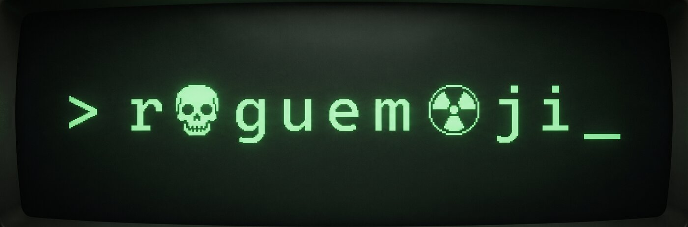
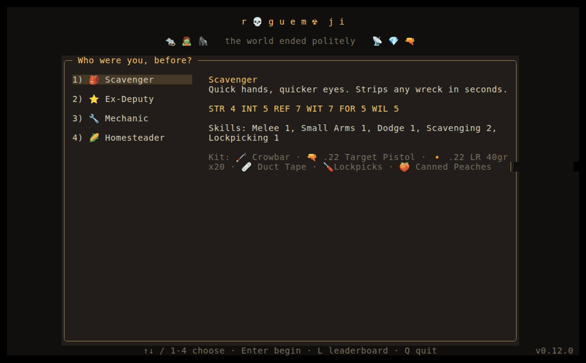
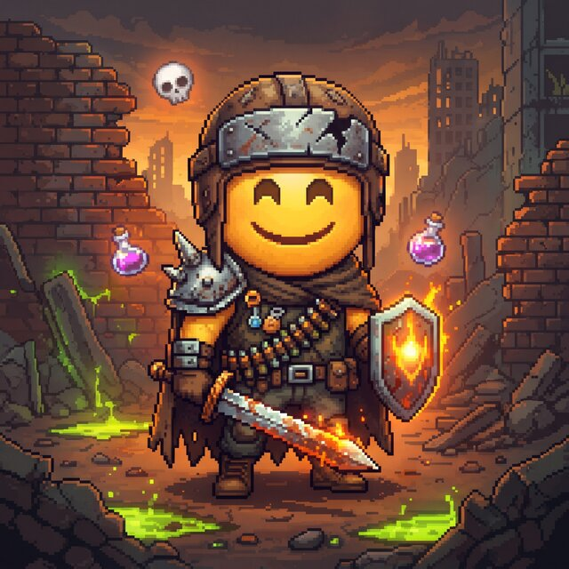

  

**roguemoji** is a moddable roguelike you play in your terminal, drawn entirely in
Unicode and emoji. No fancy graphics. Just fun.

The Visitors came, took nothing, and left. Since then, animals have mutated, cryptids
have stopped hiding, and everything that dies crystallizes into 💎 life crystals. Ten
phases of spacetime away, their Beacon 📡 still hums. Go find it.

  

## What makes it different

- **Emoji all the way down.** 🐀 rats, 🐻 bears, 🦋 Mothman, and you. If your terminal
  shows emoji, it shows roguemoji.
- **Cryptids, not orcs.** Bigfoot, the Jersey Devil, the Wendigo, the Chupacabra and the
  Dover Demon roam a near-future wasteland of ruins and glowing wastes.
- **Real guns, real physics.** Fourteen civilian firearms, from a .22 to a .308. Every
  bullet's damage comes from its real weight, its muzzle velocity and the gun's barrel
  length.
- **Your health is your money.** 💎 Crystals heal you or buy gear from Autovends. You
  can't have both.
- **Stay alive in every way.** Hunger, thirst, sleep and *hope* all run down. Drink the
  dirty water and roll the dice, or nap where a monster might find you.
- **Strange encounters.** Share a campfire, take a stranger's gift, witness horrors, or
  stake your crystals with a card sharp.
- **Scavenge and craft.** Strip wrecks and toolboxes for parts. Make nail bats, scrap
  armor, mutant stew and cryptid tonic.
- **Pounds and inches.** Everything you carry has a weight, and every pound slows you down.
- **Portals, not stairs.** Each phase is a new world, and some of your gear can follow
  you there through the Visitors' shared lockboxes.
- **Mod everything.** Every monster, gun, bullet, recipe, encounter and harvest node is a
  plain text file. Change one and the game picks it up, no compiler needed.

 

## PLAY NOW

Open **[fazigu.org/roguemoji/play](https://fazigu.org/roguemoji/play)** in your browser
and you're in. Nothing to install, no account.

Prefer a real terminal? Run `ssh roguemoji@fazigu.org`. The password is in the login
banner.

Or download it for Linux or Windows from
[Releases](https://github.com/ronstr8/roguemoji/releases). Any terminal of 80×24 or
larger works, as long as it draws emoji double-width (most modern ones do). On Windows,
use Windows Terminal.

New here? Press `?` in the game, or read the [player's guide](docs/GUIDE.md).

## MOD NOW

1. Get the code: `git clone https://github.com/ronstr8/roguemoji && cd roguemoji`
2. Install Rust with [rustup](https://rustup.rs).
3. Edit anything under `data/`: make rats meaner in `data/monsters/rat.toml`, or copy a
   gun file and invent your own. [data/README.md](data/README.md) explains every field.
4. Run `make run`. Your changes are in the game.

That's all there is! The downloads ship with the same `data/` folder beside the game,
so you can mod those without building anything. Curious about the code? See the
[developer notes](docs/DEVELOPER.md).
